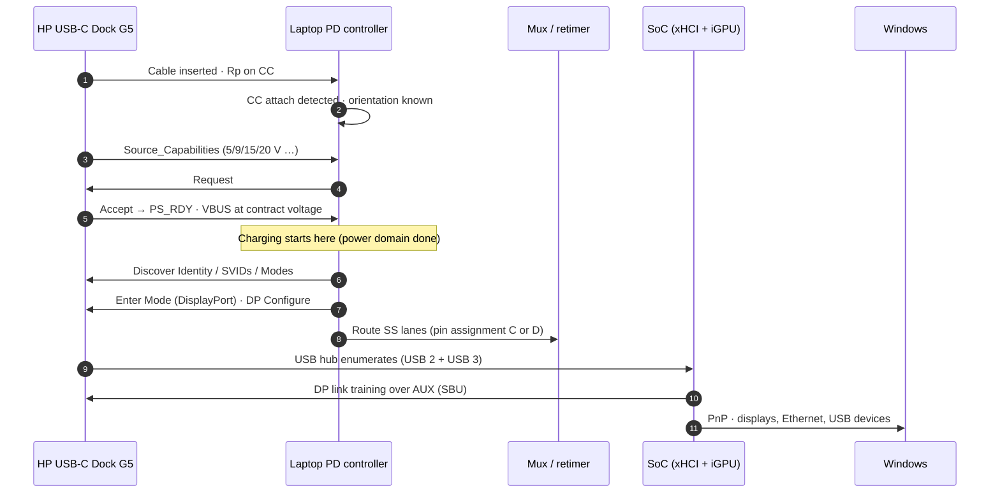
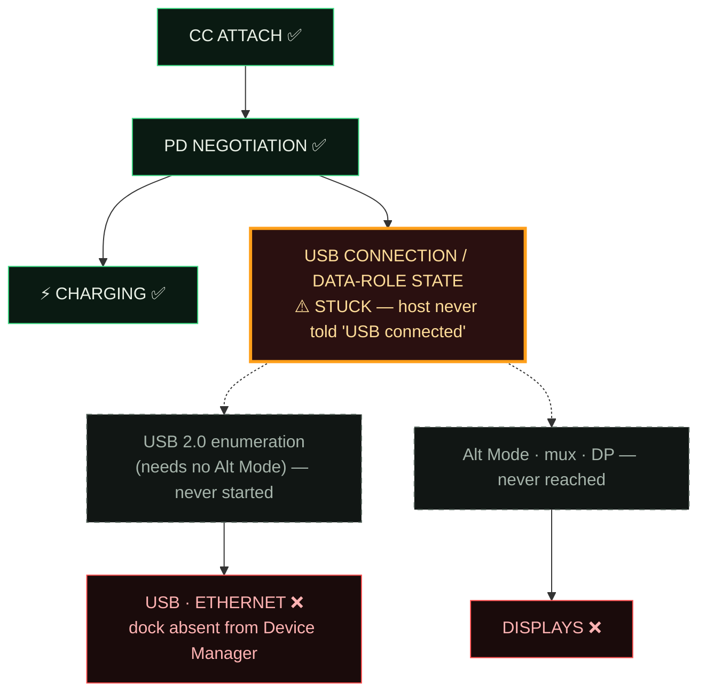
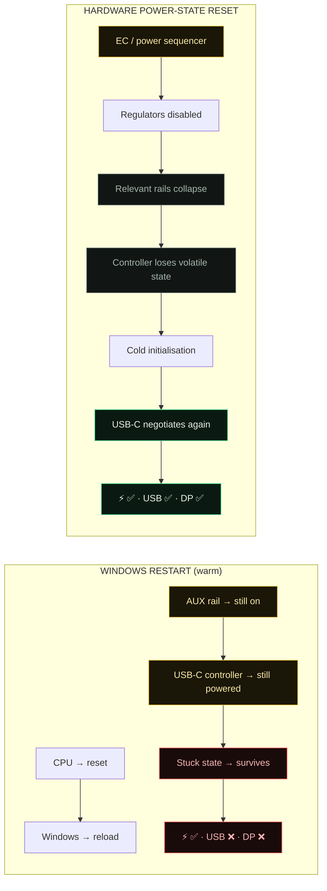
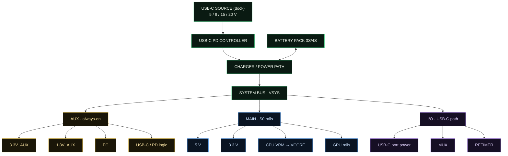
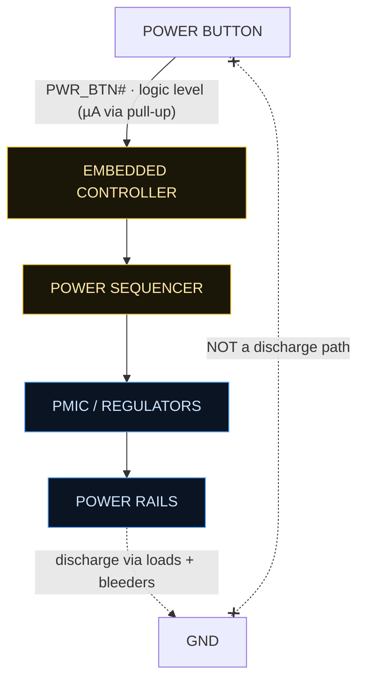
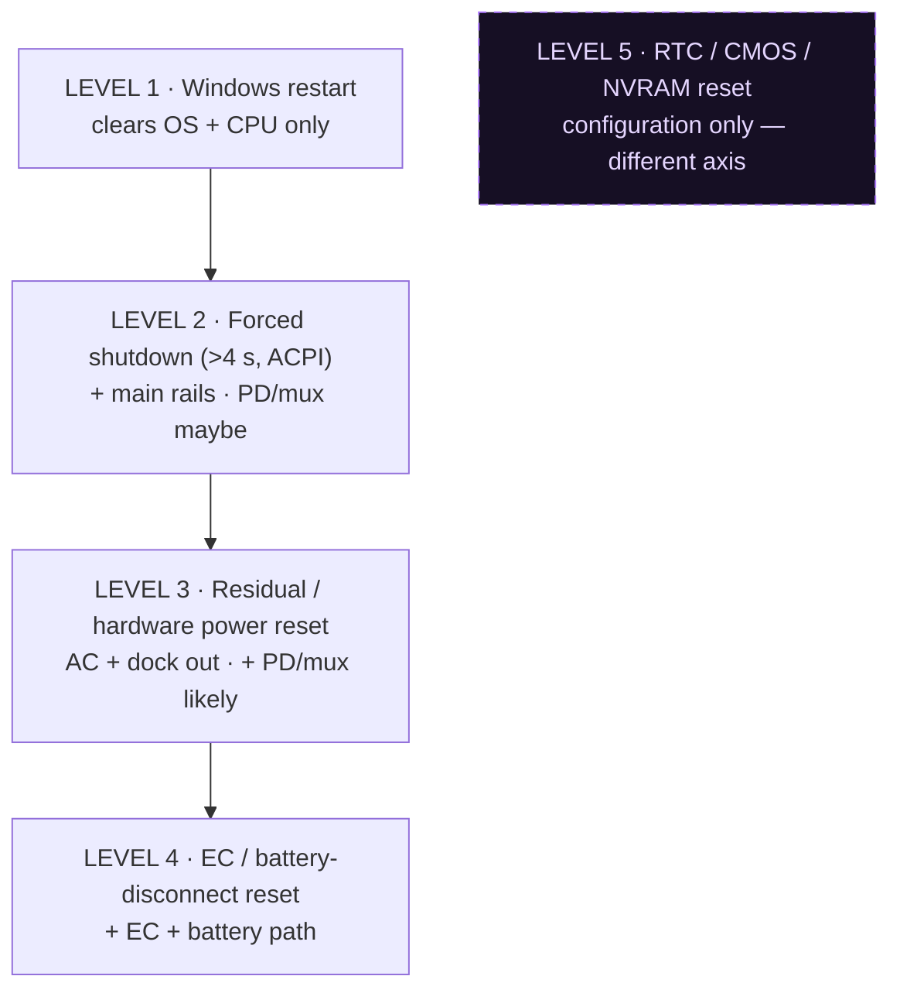
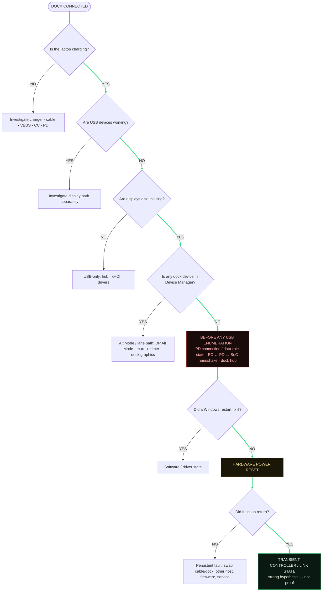
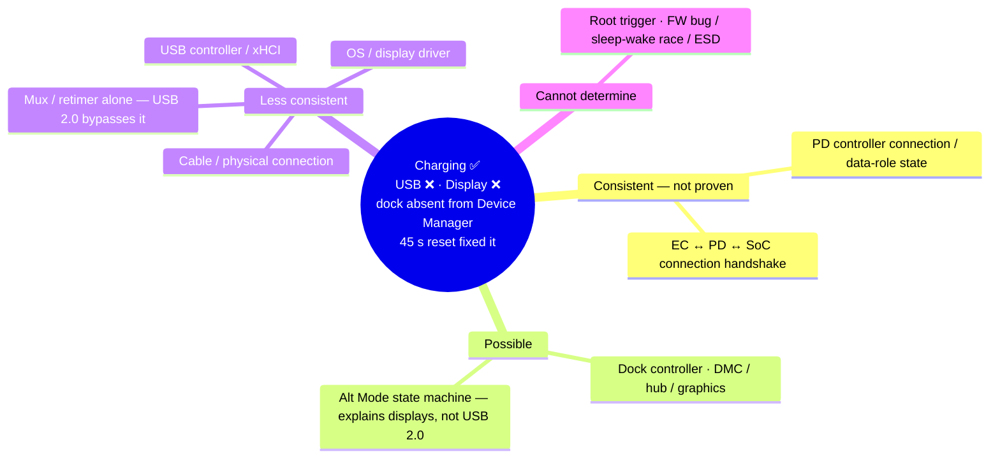

# Mermaid versions

Lightweight versions of the main diagrams. They render natively on GitHub, in most wikis and in claude.ai artifacts. Colours follow the module's code: green = power / working, yellow = always-on, blue = main rails, purple = USB-C data, red = stuck, grey = off.

## FIG 04 · Normal USB-C dock bring-up

## FIG 05 · Failure state

## FIG 06 · Restart vs hardware power-state reset

## FIG 07 · Power tree (representative)

## FIG 09 · Power-button path

## FIG 13 · Reset depth

## FIG 14 · Documented hold times (seconds)

```mermaid
gantt
    title OEM-documented power-button procedures (0–60 s)
    dateFormat X
    axisFormat %S
    section ACPI (all PCs)
    Power-button override > 4 s      :milestone, 4, 0s
    section HP
    Power (hard) reset ≈ 15 s        :milestone, 15, 0s
    section Dell
    Hard reset / flea power 15–20 s  :15, 20
    RTC reset window 25–40 s         :done, 25, 40
    RTC reset recommended 30–35 s    :crit, 30, 35
    section Microsoft Surface
    Older models ≈ 15 s              :milestone, 15, 0s
    Force restart ≈ 20 s             :milestone, 20, 0s
    section This incident
    45 s hold                        :active, 45, 46
```

## FIG 16 · Diagnostic decision tree

## FIG 21 · Hypothesis map

